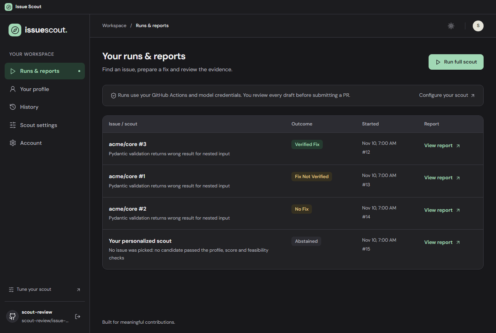

<div align="center">


# Issue Scout

### Find your next contribution. Review the evidence. Make it yours.

A Windows desktop workspace for finding open-source issues that fit your skills,
preparing draft fixes and reviewing what Scout could actually validate.

<p>
  <a href="LICENSE"></a>
  <a href="https://github.com/atty57/issue-scout-app/releases/tag/v0.1.0"></a>
  
  
</p>

**[Download the Windows installer (.exe)](https://github.com/atty57/issue-scout-app/releases/download/v0.1.0/Issue-Scout-Setup-0.1.0-x64.exe)**

[Release notes and checksum](https://github.com/atty57/issue-scout-app/releases/tag/v0.1.0) ·
[Get started](#getting-started) · [Roadmap](#roadmap) ·
[Report an issue](https://github.com/atty57/issue-scout-app/issues)

<sub>Free, MIT-licensed desktop app. Scouting uses your GitHub Actions minutes and model credentials.</sub>

<br><br>



<sub>Interface preview using offline sample data, not live contribution results.</sub>

<p><em>Electron · React · TypeScript · Your GitHub Actions</em></p>

</div>

> [!IMPORTANT]
> **This Windows beta is unsigned.** Windows may display an unknown-publisher or SmartScreen warning,
> or block installation on managed computers. The release includes a SHA-256 checksum.
> macOS support and automatic app updates are not available yet.

## Contents

- [What it does](#what-it-does)
- [How it works](#how-it-works)
- [Getting started](#getting-started)
- [Models and languages](#models-and-languages)
- [Your data and costs](#your-data-and-costs)
- [Roadmap](#roadmap)
- [Development](#development)
- [Contributing](#contributing)
- [License and acknowledgements](#license-and-acknowledgements)

## What it does

Issue Scout connects to your private copy of the
[Scout engine](https://github.com/atty57/issue-scout-template). Set your preferences in the app,
run Scout in your own GitHub Actions, then review the outcome, validation evidence and available patch.

| In your workspace | What you can do |
| --- | --- |
| **Runs & reports** | Start or stop a scout, follow its status, inspect recorded outcomes and download saved artifacts. |
| **Your profile** | Describe your skills, preferred languages and the work you want to contribute. |
| **History** | See issues recorded by your Scout repository. |
| **Scout settings** | Configure Discovery, Models, Schedule and optional Email reports. |
| **Account** | Manage GitHub sign-in and the Scout repository connected on this computer. |

The interface distinguishes verified fixes, unverified drafts, no-fix outcomes and runs with no suitable issue.
A successful GitHub Actions run alone does not count as a verified fix. When evidence is missing or unavailable,
the app says so.

**You decide what to contribute.** Scout prepares drafts and evidence for your review; it does not claim issues,
post comments or open pull requests on target projects for you.

## How it works

```text
Issue Scout desktop
        |
        | GitHub API
        v
Your private Scout repository
        |
        | Your GitHub Actions + chosen models
        v
Discover -> shortlist -> check suitability -> draft -> validate -> save report
        |
        v
Review the outcome and available patch in the app
```

1. **Connect GitHub.** Sign in through GitHub's device authorization flow.
2. **Make Scout yours.** Create a private repository from the template or connect an existing Scout copy.
3. **Choose the work and models.** Set your profile, discovery preferences and credentials for each stage.
4. **Run or schedule a scout.** Work happens in your repository's GitHub Actions.
5. **Review before contributing.** Read the brief, patch, validation logs and PR preparation material.

The desktop app manages your repository. The separate template supplies the engine that runs each scout.

## Getting started

### Install the app

**[Download Issue-Scout-Setup-0.1.0-x64.exe](https://github.com/atty57/issue-scout-app/releases/download/v0.1.0/Issue-Scout-Setup-0.1.0-x64.exe)**

Run the installer, open Issue Scout, then:

1. Sign in with your own GitHub account.
2. Create a new private Scout repository or connect an existing one.
3. Save your profile and discovery preferences.
4. Open **Scout settings → Models**, choose your models and save their credentials until setup is complete.
5. Open **Runs & reports** and select **Run full scout**.

You do not need to clone this repository, install Node.js or set up GitHub CLI to use the installer.
You do need access to GitHub Actions and valid credentials for your chosen models.

### Check the download

Compare the downloaded installer's hash with `SHA256SUMS.txt` on the
[release page](https://github.com/atty57/issue-scout-app/releases/tag/v0.1.0):

```powershell
Get-FileHash .\Issue-Scout-Setup-0.1.0-x64.exe -Algorithm SHA256
```

The checksum helps detect a changed download; it does not replace a publisher signature.

### Existing repositories and updates

An existing Scout repository keeps the engine version it was created with. Older engines may not save structured
outcomes, so their reports can appear as **Completed** without verified/unverified details. Connecting the app
does not upgrade that engine automatically.

App updates are currently manual: download a newer installer and run it over the existing installation.
Your saved account data is preserved. The app does not check for or install updates automatically.

## Models and languages

Choose models independently for issue picking and fix drafting.

| Provider | Supported stages | Authentication |
| --- | --- | --- |
| Claude Code | Picking and drafting | Subscription token or API key |
| Codex | Picking and drafting | API key |
| OpenAI | Picking and drafting | API key |
| Anthropic | Picking and drafting | API key |
| OpenAI-compatible HTTPS endpoint | Picking and drafting | API key |
| Groq | Picking only | API key |

Provider access and billing depend on your own account. Subscription authentication is not offered for Codex on
GitHub-hosted runners. A custom endpoint must be reachable from the GitHub Actions runner.

The app knows **Python, JavaScript, TypeScript, C#, C, Go, Rust, Java and C++**, plus documentation contributions.
The available languages follow the connected repository's engine capabilities; older repositories may offer fewer.
Validation also depends on whether Scout can build and test the target project in an available runtime.

## Your data and costs

- **Scouting runs in your account.** GitHub Actions minutes and model usage belong to you and are subject to
  your accounts' limits and pricing.
- **The desktop app is free.** Optional report emails use the maintainer's hosted relay and Resend account,
  with delivery limits to control the shared cost.
- **Your configuration lives in your private Scout repository.** Model credentials are saved as GitHub Secrets;
  the profile and scouting settings are stored in `profile.json`.
- **GitHub sign-in stays in the main process.** The app stores its token through Electron's `safeStorage`.
  The sandboxed renderer never receives that token.
- **Email is opt-in.** Enabling it requires address confirmation. The relay processes the delivery address and
  report email content; the maintainer's Resend API key stays on the relay.

Disconnecting a repository only forgets this computer's link; it does not delete the repository on GitHub.
Signing out or disconnecting does not erase email records already held by the relay.

## Roadmap

- [ ] CI/CD to test, build and publish Windows releases.
- [ ] Code signing for Windows installers and update packages.
- [ ] In-app update checks and automatic (OTA) updates after code signing is established.
- [ ] Scout engine updates that preserve existing repositories' settings and data.
- [ ] macOS support; currently deferred while Windows is the supported platform.

## Development

The steps below are for contributors. Installer users can skip this section.

```sh
git clone https://github.com/atty57/issue-scout-app.git
cd issue-scout-app
npm ci
npm start
```

| Command | Purpose |
| --- | --- |
| `npm test` | Run frontend journeys and Electron backend tests. |
| `npm run build` | Type-check and build the production renderer. |
| `npm start` | Build and launch Electron. |
| `npm run dist:win` | Build a local Windows x64 installer in `release/`; never publishes. |

The optional signed-build tooling is documented in [RELEASING.md](RELEASING.md). No signing service is configured
for the current unsigned beta.

```text
src/        React interface, shared components and frontend tests
electron/   Main process, GitHub integration, preload bridge and backend tests
build/      Application icons and optional signing configuration
scripts/    Release build and signature-verification helpers
```

The renderer calls one IPC request channel through `window.scout.request`; backend routes handle GitHub access in
the main process. The [template repository](https://github.com/atty57/issue-scout-template) contains the separate
scouting engine and Actions workflows copied into each user's private repository.

## Contributing

[Report bugs or suggest improvements](https://github.com/atty57/issue-scout-app/issues).
Include your app version, steps to reproduce and the expected versus actual behavior. Do not include tokens,
model keys, device authorization codes or private reports in public issues.

For code changes, keep tests offline, run `npm test` and `npm run build`, and include screenshots for interface
changes. Preserve the distinction between recorded validation evidence and unavailable results.

## License and acknowledgements

Issue Scout desktop is licensed under the [MIT License](LICENSE).
Third-party components retain their respective licenses.

- [Beautiful UI](https://www.beautifului.dev/) for the adapted presentation patterns; attribution is included in
  [THIRD_PARTY_NOTICES.md](THIRD_PARTY_NOTICES.md).
- [Electron](https://www.electronjs.org/), [React](https://react.dev/) and [TypeScript](https://www.typescriptlang.org/)
  for the application stack.
- [Issue Scout template](https://github.com/atty57/issue-scout-template) for the engine and GitHub Actions workflows.
